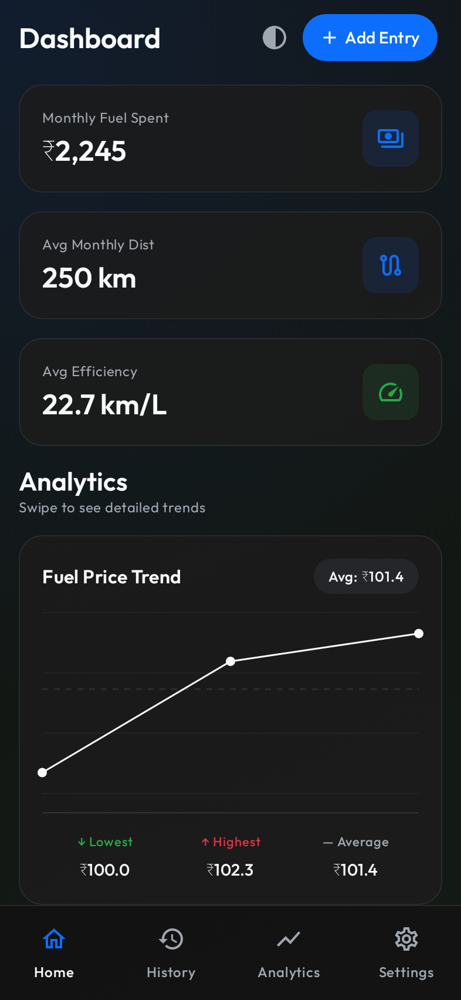

# Native reference UI (version 1.1)

The visual and navigation reference is `thisisarindam/mileage-tracker` at commit `5b09ad636b21cd853076bc0ba78308ce27aebe9f`. Its CSS, dashboard/history/analytics/settings markup and calculation scripts were inspected locally. The source repository remains unchanged and its Supabase project was never contacted.

| Reference | Android implementation |
| --- | --- |
| Outfit typeface | Bundled variable font, licensed in `licenses/OFL-Outfit.txt`; no font requests |
| Dark `#121212`, light `#f0f2f5`, translucent cards | Native Material 3 themes, static blue/green background gradients, 20 dp rounded cards |
| Blue `#0d6efd` pill buttons, green `#28a745` efficiency | Compose buttons, local vector icons and mileage badges |
| Home / History / Analytics / Settings | Four persistent bottom navigation destinations; tab scroll/pager state retained |
| Dashboard quick stats | Monthly fuel spending, inclusive-span average monthly distance, dashboard lifetime efficiency |
| Swipeable analytics carousel | Local Canvas price, running-cost and efficiency graphs, mean lines, lowest/highest/average summaries and accessible descriptions |
| Recent Logs → View All | Latest ten fill-ups and a direct route into full History |
| Add Entry overlay | Native bottom sheet offering Fuel Fill-up and Maintenance; native forms and date picker |
| Fuel Fillups / Maintenance pills | Native history tabs with last-month summary, record details, mileage badges, edit and delete |
| Insights & Analytics | Month summary, savings, horizontal monthly comparison cards, year/all-time statistics, station efficiency bars |
| Preferences and appearance | Metric units, currency dropdown / Save Settings, persisted dark/light switch and Dashboard theme toggle |

Import & Backup remains available in Settings, including both original CSV import actions, validation previews, full JSON save/restore and per-history CSV exports. There is no login/logout or animation-settings UI. Background motion, CSS blur, Chart.js, Bootstrap, remote fonts and remote assets are not embedded in the app.

The History single-fill month fallback and the dashboard/analytics mileage denominator differences are preserved. Running-cost and station-efficiency series use consecutive chronological records with positive distance and litres, as in the reference scripts. Graph drawing samples very long series to 120 plotted points; summaries use all data. Station bars show the first 12 named stations and label that limit when there are more.

## Previews

These are native Compose software-rendered previews from Robolectric at a 393 × 852 dp phone size. All displayed records are synthetic test fixtures. They are not screenshots from a physical Nothing Phone 2a.

| Dark Dashboard | Light Dashboard |
| --- | --- |
|  |  |

The test run also produces History, Analytics and Settings previews in `app/build/reports/ui/`. GitHub Actions uploads them as `ui-previews` alongside the APK/test artifacts.

## Data compatibility

Room schema version 2 adds only a `darkTheme` preference with a default of true; it migrates schema 1 without deleting or rewriting histories. Tests open a real schema-1 SQLite database and verify retained source IDs, decimal strings, notes and currency after migration. JSON exports now use format version 2 so theme is backed up; version-1 JSON restores remain supported, defaulting to dark appearance. All record transactions and duplicate protection remain in Room.

## Device check

Follow the README airplane-mode test. Additionally verify horizontal swipes in Dashboard trends and monthly comparison; both History tabs; Add Entry selection, calendar and keyboard; light/dark persistence; large font sizes; and import/restore confirmations. Robolectric interaction tests cover navigation, form saves, preference saves, activity recreation and the reachability of file-picker actions, but do not replace physical-device touch, performance or file-provider testing.
