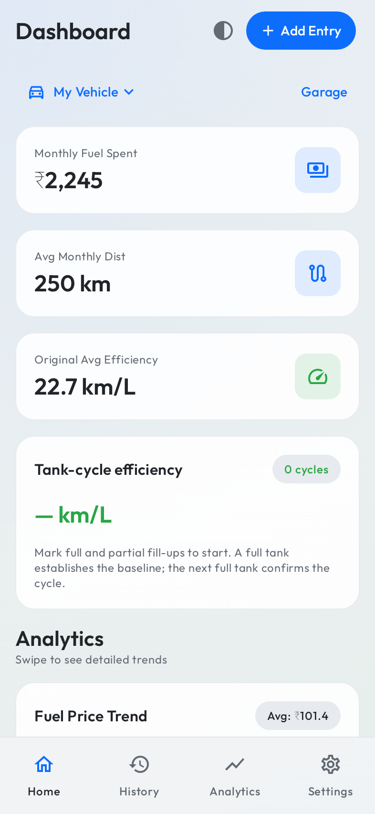
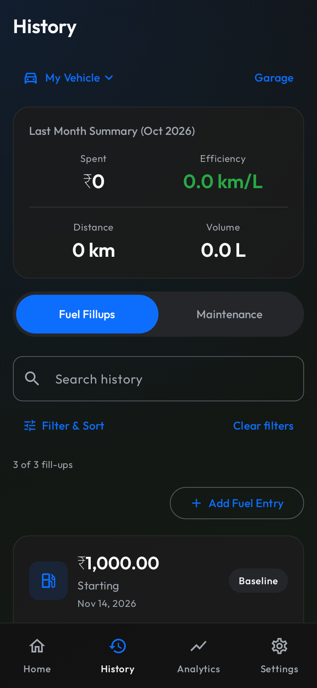
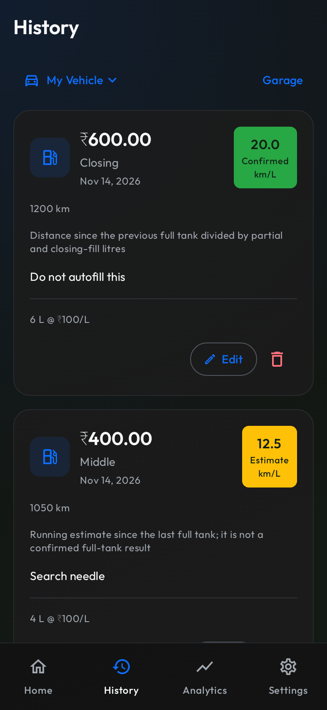

# Native reference UI and core upgrade (version 1.2)

The visual and navigation reference is `thisisarindam/mileage-tracker` at commit `5b09ad636b21cd853076bc0ba78308ce27aebe9f`. Its CSS, dashboard/history/analytics/settings markup and calculation scripts were inspected locally. The source repository remains unchanged and its Supabase project was never contacted.

| Reference | Android implementation |
| --- | --- |
| Outfit typeface | Bundled variable font, licensed in `licenses/OFL-Outfit.txt`; no font requests |
| Dark `#121212`, light `#f0f2f5`, translucent cards | Native Material 3 themes, static blue/green background gradients, 20 dp rounded cards |
| Blue `#0d6efd` pill buttons, green `#28a745` efficiency | Compose buttons, local vector icons and mileage badges |
| Home / History / Analytics / Settings | Four persistent bottom navigation destinations; tab scroll/pager state retained |
| Dashboard quick stats | Monthly fuel spending, inclusive-span average monthly distance, dashboard lifetime efficiency |
| Swipeable analytics carousel | Local Canvas price, running-cost and efficiency graphs, mean lines, lowest/highest/average summaries and accessible descriptions |
| Recent Logs → View All | Latest ten fill-ups and a direct route into full History |
| Add Entry overlay | Native bottom sheet offering Fuel Fill-up and Maintenance; native forms and date picker |
| Fuel Fillups / Maintenance pills | Native history tabs with last-month summary, record details, mileage badges, edit and delete |
| Insights & Analytics | Month summary, savings, horizontal monthly comparison cards, year/all-time statistics, station efficiency bars |
| Preferences and appearance | Metric units, currency dropdown / Save Settings, persisted dark/light switch and Dashboard theme toggle |
| Core upgrade inspired by the reviewed mileage app | Per-vehicle histories, garage management, safe station/price autofill, full/partial/missed tank tracking and separately labelled tank-cycle analytics |
| History tools | Debounced search, inclusive date/station filters and cached numeric cost/date sort orders; calculations use unfiltered history |
| Native motion | Interruptible tab slide/fade, dialog window transitions, bounded chart reveal, metric crossfade and keyed list changes; reduced-motion preference |

Import & Backup remains available in Settings, including both original CSV import actions, validation previews, full JSON save/restore and per-history CSV exports. Reduced motion is a local native preference. Background-orb controls, login/logout, CSS blur, Chart.js, Bootstrap, remote fonts and remote assets are not embedded in the app. No code or assets from the inspected third-party APK were copied into this implementation.

The History single-fill month fallback and the dashboard/analytics mileage denominator differences are preserved. Running-cost and station-efficiency series use consecutive chronological records with positive distance and litres, as in the reference scripts. Graph drawing samples very long series to 120 plotted points; summaries use all data. Station bars show the first 12 named stations and label that limit when there are more.

## Previews

These are native Compose software-rendered previews from Robolectric at a 393 × 852 dp phone size. All displayed records are synthetic test fixtures. They are not screenshots from a physical Nothing Phone 2a.

| Dark Dashboard | Light Dashboard |
| --- | --- |
|  |  |

The test run also produces History, Analytics and Settings previews in `app/build/reports/ui/`. GitHub Actions uploads them as `ui-previews` alongside the APK/test artifacts.

| History search and filters | Explicit tank-cycle records |
| --- | --- |
|  |  |

Motion uses short 90–240 ms transitions and no infinite animation loops. The calculation dispatcher prepares chart samples and summaries once per history update. Each chart draws at most 120 points; scrolling composes visible rows with stable IDs. Search keeps cached numeric sort orders and normalized text, debounces for 120 ms and cancels superseded work. Changing appearance reuses the same history index and insights. The native file picker retains Android's system transitions.

## Data compatibility

Room schema version 3 introduces vehicles, foreign keys, tank/missed fields and selected-vehicle/reduced-motion preferences. Real schema-1 and schema-2 migration tests verify retained fuel/service values, source IDs, notes, currency and appearance. Existing records default to **My Vehicle / Unspecified**. JSON version 3 saves the entire garage; v1/v2 restores remain supported. Imports and CSV exports use the selected vehicle, while source IDs stay unique across the garage for each record type. Restore validates all references and replaces records/vehicles/preferences atomically. See README for the independent tank-cycle algorithm and original formulas.

## Device check

Follow the README airplane-mode test. Additionally verify rapid navigation; horizontal swipes; large-history scrolling and search; vehicle switching; both History tabs; Add Entry, autofill, calendar and keyboard; light/dark and reduced-motion persistence; large fonts; and import/restore confirmations. Robolectric interaction tests exercise these core flows, including a 1,003-record history and activity recreation, but do not measure physical-device frame pacing or replace file-provider testing.
